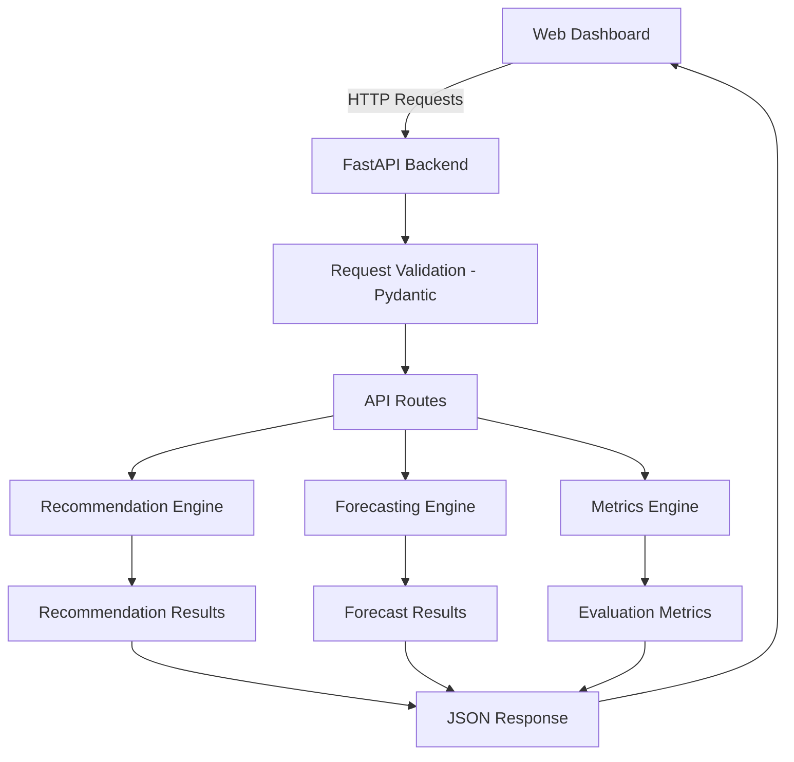

# Dobby API System

A REST API for restaurant intelligence, providing product recommendations, demand forecasting and performance metrics.

Developed as part of the **4th Student Open Innovation Competition of the National and Kapodistrian University of Athens (NKUA)**, held on November 6–8, 2026.

The project was developed in a time-constrained, hackathon-style environment, using AI-assisted development as part of the implementation process.

## Project Overview

The API serves as the backend of a restaurant analytics platform, exposing endpoints for:

- **Product Recommendations:** Suggests complementary products and potential upgrades based on a customer's shopping basket.
- **Demand Forecasting:** Predicts future product demand using historical sales data and forecasting models.
- **Performance Metrics:** Evaluates recommendation and forecasting performance against baseline approaches.

The API is designed to communicate with a separate web dashboard, providing the underlying functionality and data required by the interface.

## Related Project

The complete application consists of two interconnected components:

| Component | Description |
|---|---|
| **Backend API** | This repository. Provides the REST API and core analytical functionality. |
| **Web Dashboard** | [Dobby Web Dashboard](https://github.com/konsamarinas/Dobby-web-dashboard) — A Flask-based interface for interacting with the API and visualizing restaurant analytics. |

**Live Services:**

- [API Documentation (Swagger UI)](https://dobby-api-system.onrender.com/docs)
- [Web Dashboard](https://dobby-web-dashboard.onrender.com)

## Features

### 1. Product Recommendations

The recommendation engine generates up to three product suggestions based on the items already present in a shopping basket.

It considers several factors:

- Catalog compatibility.
- Conditional basket purchase patterns.
- Time-related context.
- Product popularity.
- Upgrade opportunities.

The scoring mechanism combines these factors using the following weighted formula:

```text
score =
    0.35 * catalog_compatibility +
    0.25 * conditional_basket_purchase +
    0.15 * time_context +
    0.05 * normalized_popularity +
    0.20 * upgrade_quality
```

The objective is to identify relevant complementary products (cross-selling) and potential upgrades (upselling), helping restaurants increase the average basket value.

### 2. Demand Forecasting

The forecasting module estimates future demand for products or product categories.

It includes multiple forecasting approaches:

- Seasonal Naive.
- Seasonal Average.
- Random Forest.

Models are evaluated using chronological validation and rolling-origin WAPE.

The default forecasting horizon is 7 days, with supported values ranging from 1 to 14 days.

Time-related operations use the `Europe/Athens` timezone.

### 3. Performance Metrics

The API provides metrics for evaluating the recommendation and forecasting systems.

**Recommendation metrics:**
- HitRate@3.
- Baseline HitRate@3.

**Forecasting metrics:**
- WAPE.
- Baseline WAPE.

These metrics allow the system to compare its approaches against simpler baseline methods.

## API Endpoints

| Method | Endpoint | Description |
|---|---|---|
| GET | `/health` | Checks API health and availability. |
| POST | `/recommendations` | Generates product recommendations for a shopping basket. |
| POST | `/forecast` | Generates future demand forecasts. |
| GET | `/metrics` | Returns recommendation and forecasting evaluation metrics. |

Interactive API documentation is available through Swagger UI:

**[Open API Documentation](https://dobby-api-system.onrender.com/docs)**

## Technology Stack

| Technology | Purpose |
|---|---|
| Python | Core programming language |
| FastAPI | REST API framework |
| Pydantic v2 | Data validation and schemas |
| Pandas | Data processing and manipulation |
| NumPy | Numerical computations |
| Scikit-learn | Machine learning and Random Forest forecasting |
| Uvicorn | ASGI server |
| Docker | Containerization |
| Docker Compose | Container orchestration |
| ZoneInfo | Timezone handling |

## Architecture



The backend exposes its functionality through HTTP endpoints, while the separate Flask dashboard consumes these endpoints through a centralized API client.

## Data and Evaluation

The current implementation uses deterministic synthetic, Dobby-compatible nested JSON fixtures to simulate the data required by the analytical components.

This allows the API to demonstrate its functionality without depending on real restaurant or customer datasets.

**Important limitations:**

- The current data is synthetic and does not represent actual restaurant transactions.
- Evaluation metrics are generated in an offline environment.
- Forecasting and recommendation results have not been validated through a live commercial deployment.
- The reported metrics should not be interpreted as measured business impact.

The recommendation and forecasting approaches are intended as a working technical implementation and a foundation for further experimentation.

## Running Locally

### Prerequisites

- Python 3.10+
- pip

### Installation

Clone the repository and navigate to its directory:

```bash
git clone <repository-url>
cd Dobby-APi-System
```

Create and activate a virtual environment:

```bash
python -m venv .venv
```

On Linux/macOS:

```bash
source .venv/bin/activate
```

On Windows:

```bash
.venv\Scripts\activate
```

Install dependencies:

```bash
pip install -r requirements.txt
```

### Start the API

Run the application using Uvicorn:

```bash
uvicorn src.main:app --reload
```

The API will be available at:

```text
http://127.0.0.1:8000
```

Interactive documentation:

```text
http://127.0.0.1:8000/docs
```

*The exact startup command may depend on the repository's current configuration.*

## Deployment

The API is deployed on **Render** and exposes its endpoints publicly.

- **API Base URL:** https://dobby-api-system.onrender.com
- **Swagger Documentation:** https://dobby-api-system.onrender.com/docs

The web dashboard communicates with this deployed API through HTTP requests.

## Project Context

This project was developed during the 4th Student Open Innovation Competition of NKUA (November 6–8, 2026).

It explores how recommendation systems, machine learning and data analytics can be combined to support restaurant operations and business decision-making.

The implementation represents a prototype developed within the competition's time constraints, with room for further development, real-world data integration and evaluation.

## License

This project is licensed under the MIT License. See the `LICENSE` file for details.

Copyright (c) 2026 Dobby Team
