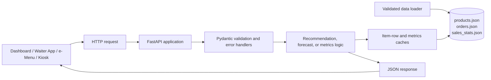

# DOBBY Restaurant Analytics API

DOBBY is a FastAPI backend for restaurant recommendations, demand
forecasting, and model evaluation. It uses Dobby-compatible nested JSON
fixtures, validates them at startup, and exposes a small HTTP API suitable for
a restaurant dashboard, waiter application, e-menu, or kiosk.

The current implementation is an MVP built around deterministic statistical
methods and synthetic data. It does not use deep learning, neural networks,
LLMs, online learning, or an external database.

## Overview

The API currently provides:

- Cart-aware product recommendations.
- Product- and category-level daily demand forecasts.
- Recommendation and forecasting evaluation metrics.
- Health and model-version reporting.
- OpenAPI documentation through FastAPI.
- Configurable browser CORS.
- Startup validation for the required datasets.

The production API uses the recommendation and forecasting logic in
[`src/main.py`](./src/main.py). The modules under
[`src/recommendations/`](./src/recommendations/) contain reusable offline
recommendation experiments and evaluation utilities; they are not the active
API recommender.

## Key features

| Area | Current implementation |
| --- | --- |
| Recommendations | Metadata-aware compatibility, conditional co-occurrence, context, popularity, explainable upsells, and diversity |
| Forecasting | Same-weekday seasonal averages with heuristic uncertainty intervals |
| Evaluation | Chronological recommendation evaluation and rolling-origin WAPE |
| Data | Deterministic synthetic Dobby-format products, orders, and sales statistics |
| Validation | Startup schema, reference, timestamp, category, price, and quantity checks |
| API documentation | `/docs`, `/redoc`, and `/openapi.json` |
| Runtime caching | Cached item-row preprocessing and cached metrics results |

## Architecture



### Runtime flow

1. `src.main` loads the three required JSON files during import.
2. `src.core.data_loader` validates IDs, references, timestamps, categories,
   product flags, prices, order types, item IDs, and quantities.
3. Orders are indexed by business and sorted by absolute UTC timestamp.
4. FastAPI validates incoming request bodies and query parameters with Pydantic.
5. Endpoint logic reads the in-memory validated data.
6. Response models and custom error handlers produce the HTTP response.

## Technical stack

- Python 3.12-compatible runtime
- FastAPI
- Uvicorn
- Pydantic v2
- pandas
- NumPy
- Python `zoneinfo`
- Docker and Docker Compose support

Dependencies are declared in [`requirements.txt`](./requirements.txt), the
single dependency manifest used by local setup and Docker.

## How it works

### Recommendation engine

The active production recommender is `recommendation_candidates()` in
[`src/main.py`](./src/main.py).

#### Candidate eligibility

Before ranking, the API:

- Requires a known `business_id`.
- Requires all cart product IDs to belong to that business.
- Keeps only products where `available` and `published` are true.
- Requires the requested order type to be listed in the product's
  `order_types`.
- Excludes products already in the cart from ordinary recommendations.

Supported order types are:

- `dine_in`
- `delivery`
- `takeaway`

Supported channels are:

- `waiter_app`
- `e_menu`
- `kiosk`

The channel is validated and returned behavior is currently independent of the
channel value.

#### Ranking

The production score is normalized to `[0, 1]` and combines:

```text
0.35 * catalog_compatibility
+ 0.25 * conditional_basket_purchase
+ 0.15 * time_context
+ 0.05 * normalized_popularity
+ 0.20 * upgrade_quality
```

Compatibility comes from catalog `complement_groups` metadata, while
conditional basket purchase is computed from historical baskets that contain
at least one cart item. Popularity is intentionally small so a popular but
unrelated item cannot outrank a relevant complement. An upgrade receives a
quality component only when its explicit `upgrade_group` and higher
`upgrade_rank` identify it as a genuine, higher-priced replacement.

The ranker excludes unavailable, unpublished, out-of-order-type, and
already-carted products. It caps repeated categories and duplicate upgrade
groups, and returns fewer than `limit` results when the evidence is weak.
Reasons identify whether the result came from an upgrade, historical
co-occurrence, or catalog compatibility.

The returned price is in euro cents and is selected from:

- `price_store` for `dine_in`
- `price_delivery` for `delivery`
- `price_takeaway` for `takeaway`

#### Current limitations

- Compatibility metadata is curated at catalog-generation time; production
  catalogs should provide equivalent relationship metadata.
- Cart quantities, selections, and extras are validated but do not yet change
  the ranking calculation.
- The experimental association, similarity, and hybrid modules remain
  reusable offline implementations and are not the active API pipeline.

### Synthetic data generation

`src/generate_mock_data.py` uses a configurable seed and creates explicit
product tags, complement groups, and upgrade groups. Orders select a primary
product and then sample compatible companions rather than arbitrary products.
Business profiles apply different category preferences, peak hours, order-type
mixes, and weekend/season effects. Regenerate the committed fixtures with:

```bash
python -m src.generate_mock_data --seed 42 --days 300 --orders-per-day 12
```

### Demand forecasting

The `/forecast` endpoint uses the centralized, leakage-safe implementation in
[`src/forecasting/engine.py`](./src/forecasting/engine.py), called by
[`src/main.py`](./src/main.py). The production model version is `fc-v2.0`.

#### Forecast behavior

- Forecasts are daily.
- The default horizon is 7 days.
- The accepted horizon is 1–14 days.
- The default forecast start is tomorrow in the `Europe/Athens` timezone.
- Historical timestamps are normalized to Athens-local time before daily
  grouping.
- Missing calendar dates are filled with zero demand.
- Product forecasts aggregate one product's item quantities.
- Category forecasts aggregate item quantities using the item's category ID.
- Optional `order_type` filtering supports `dine_in`, `delivery`, and
  `takeaway`.

Three models are available:

- `seasonal_naive`: the most recent observation for the target weekday.
- `seasonal_average`: the mean of the previous eight observations for the
  target weekday, retaining the original `fc-v1.0` behavior.
- `random_forest`: a deterministic `RandomForestRegressor` using calendar
  fields, lags 1/7/14/28, and lagged rolling means and standard deviations.

Features are built only from dates before the prediction target. Missing
calendar dates are represented as zero sales. For multi-day forecasts,
predictions are appended to the history and used for later lag features.

Model selection uses a chronological validation slice (the first 80% of the
available history, with its final 20% used for validation). Random Forest is
selected only when it has enough history and has the lowest validation WAPE;
otherwise Seasonal Average is used. The final API forecast is therefore not
selected using its future holdout.

The lower and upper values are validation-residual estimates. They are not
calibrated statistical confidence intervals. Bounds are clamped so that:

```text
0 <= lower <= quantity <= upper
```

Forecast quantities are expected demand in pieces, represented as floating
point values. They are not guaranteed to be integer production quantities.
The response identifies the interval method explicitly as
`validation residual estimate`.

#### Measured model comparison

The committed report in
[`data/forecast_evaluation.json`](./data/forecast_evaluation.json) was
generated from the current 300-day synthetic dataset using the same
chronological 80/20 holdout for every model. The following are the overall
business totals; WAPE is the primary selection metric.

| Model | MAE | RMSE | WAPE | Bias |
| --- | ---: | ---: | ---: | ---: |
| Seasonal Naive | 15.1333 | 18.6217 | 0.2371 | 1.6000 |
| Seasonal Average | 14.0125 | 16.3150 | 0.2195 | 7.6333 |
| Random Forest | 11.0721 | 13.1359 | 0.1735 | 2.5450 |

Random Forest performed best overall and was also best for the commercial and
university profiles; Seasonal Average remained best for the tourist profile.
The API selects per series using validation, so this report is evidence rather
than a hardcoded model choice. These results describe synthetic data only and
are not evidence of real-world accuracy. The report also contains measured
samples for the three highest-volume products in each business.

The response adds `total_quantity`, `selected_model`,
`evaluation_metrics`, and `interval_method` while preserving all existing
request parameters and existing forecast fields. Example:

```http
GET /forecast?business_id=shop_university&level=product&id=shop_university_prod_freddo_espresso&horizon=7
```

```json
{
  "business_id": "shop_university",
  "level": "product",
  "id": "shop_university_prod_freddo_espresso",
  "forecast": [{"date": "2026-11-08", "quantity": 12.4, "lower": 8.1, "upper": 16.7}],
  "total_quantity": 83.2,
  "selected_model": "random_forest",
  "interval_method": "validation residual estimate",
  "model_version": "fc-v2.0"
}
```

#### Forecast limitations

- The data is synthetic and does not include promotions, weather, staffing,
  holidays, or stock-outs.
- Prediction intervals are useful uncertainty estimates but are not calibrated
  probabilistic intervals.
- Inventory replenishment is not exposed because the fixture has no reliable
  current-stock field.
- Category and product forecasts are independently calculated and are only
  approximately additive after rounding.

### Business intelligence and metrics

`GET /metrics` evaluates the active production recommender and the forecasting
baseline over historical data.

#### Recommendation metrics

For each eligible test order with at least two distinct products, the
evaluation:

1. Uses the last distinct product as the hidden product.
2. Sends the remaining distinct products as the visible cart.
3. Excludes the target order and uses only earlier history.
4. Requests up to three recommendations.
5. Counts a hit when the hidden product appears in the recommendations.

Global metrics use a chronological 80/20 split over the global order
sequence. Business-specific metrics use a chronological 80/20 split after
filtering to the requested business. The response includes the methodology
string so the scope is explicit.

`baseline_hit_rate_at_3` is a historical popularity baseline using the
quantity sum by product, filtered by business and order type, and selecting
the top three products.

#### Forecast metrics

Forecast evaluation uses rolling-origin chronological evaluation from
[`src/forecasting/evaluation.py`](./src/forecasting/evaluation.py):

- Each target date is forecast using only dates before that target.
- The product-level seasonal forecast is compared with actual daily totals.
- WAPE is:

```text
WAPE = sum(abs(actual - forecast)) / sum(actual)
```

- The forecasting baseline uses the value from seven days earlier.

When total actual demand is zero, WAPE is `null`.

#### Business impact

The response includes `estimated_aov_uplift_pct` and
`estimated_waste_reduction_pct`. They are currently `null` because the
application does not have an online experiment or validated commercial
assumptions. These fields must not be interpreted as measured business
outcomes.

#### Metrics caching

Metrics calculations are cached with a standard-library `lru_cache`, keyed by
`business_id`. Global and business-specific results have separate cache
entries. Returned dictionaries are deep-copied so callers cannot mutate the
cached value. `clear_metrics_cache()` invalidates the cache after an
in-process dataset reload or replacement. The datasets are normally loaded
once at startup and remain unchanged during the process lifetime.

## API reference

The API listens on port `8000` by default when started with the documented
commands below.

### Common error format

All custom errors use:

```json
{
  "error": {
    "code": "not_found",
    "message": "Unknown business_id: unknown"
  }
}
```

Typical status codes:

| Status | Code | Meaning |
| ---: | --- | --- |
| 400 | `invalid_request` | Invalid body, missing field, or invalid request format |
| 404 | `not_found` | Unknown business, product, or category |
| 422 | `unprocessable` | Valid request shape that cannot be served, including an out-of-range forecast horizon |
| 500 | `internal_error` | Unexpected server-side failure |

### `GET /health`

Returns service and model-version status.

**Response:**

```json
{
  "status": "ok",
  "model_versions": {
    "recommendations": "rec-v1.3",
    "forecast": "fc-v1.0"
  }
}
```

### `POST /recommendations`

Returns up to three recommendations for a cart.

**Request body:**

| Field | Required | Validation |
| --- | --- | --- |
| `business_id` | Yes | Existing business identifier |
| `order_type` | Yes | `dine_in`, `delivery`, or `takeaway` |
| `channel` | No | `waiter_app`, `e_menu`, or `kiosk`; defaults to `e_menu` |
| `timestamp` | Yes | Timezone-aware ISO 8601 datetime |
| `cart` | No | List of cart items; defaults to an empty list |
| `limit` | No | Integer from 1 to 3; defaults to 3 |

Each cart item contains `product_id`, `quantity` (minimum 1),
`selection_option_ids`, and `extra_ids`.

**Verified request:**

```json
{
  "business_id": "shop_university",
  "order_type": "dine_in",
  "channel": "kiosk",
  "timestamp": "2026-10-31T09:20:00+02:00",
  "cart": [
    {
      "product_id": "shop_university_prod_freddo_cappuccino",
      "quantity": 1
    }
  ],
  "limit": 3
}
```

**Response shape:**

```json
{
  "recommendations": [
    {
      "product_id": "shop_university_prod_iced_latte",
      "name": "Κρύο latte",
      "category_id": "shop_university_cat_coffee",
      "type": "upsell",
      "replaces_product_id": "shop_university_prod_freddo_cappuccino",
      "price": 430,
      "score": 0.7688,
      "reason": "Δημοφιλής αναβάθμιση του Freddo cappuccino."
    }
  ],
  "model_version": "rec-v1.3"
}
```

The actual response can contain fewer than three recommendations depending on
eligibility and the requested limit. The `replaces_product_id` field is
omitted for cross-sell recommendations.

Possible errors include:

- `400 invalid_request` for malformed JSON, missing required fields, invalid
  order type/channel, a naive timestamp, or an invalid quantity.
- `404 not_found` for an unknown business or cart product.

### `GET /forecast`

Returns daily expected demand for one product or category.

**Query parameters:**

| Parameter | Required | Accepted values |
| --- | --- | --- |
| `business_id` | Yes | Existing business identifier |
| `level` | Yes | `product` or `category` |
| `id` | Yes | Product ID or category ID matching `level` |
| `start_date` | No | `YYYY-MM-DD`; defaults to tomorrow in Athens |
| `horizon` | No | Integer 1–14; defaults to 7 |
| `order_type` | No | `dine_in`, `delivery`, or `takeaway` |

**Verified request:**

```text
/forecast?business_id=shop_university&level=product&id=shop_university_prod_freddo_cappuccino&start_date=2026-11-08&horizon=2
```

**Response:**

```json
{
  "business_id": "shop_university",
  "level": "product",
  "id": "shop_university_prod_freddo_cappuccino",
  "name": "Freddo cappuccino",
  "order_type": null,
  "unit": "pieces",
  "interval": 0.8,
  "forecast": [
    {
      "date": "2026-11-08",
      "quantity": 0.88,
      "lower": 0.0,
      "upper": 2.0
    },
    {
      "date": "2026-11-09",
      "quantity": 1.38,
      "lower": 0.0,
      "upper": 2.81
    }
  ],
  "model_version": "fc-v1.0"
}
```

Possible errors include:

- `400 invalid_request` for malformed query values.
- `404 not_found` for an unknown business, product, or category.
- `422 unprocessable` when `horizon` is outside 1–14.

### `GET /metrics`

Runs or retrieves cached evaluation metrics. It accepts one optional query
parameter:

```text
business_id=<existing business ID>
```

Without `business_id`, the recommendation evaluation uses the global
chronological split. With `business_id`, it uses the business-local
chronological split.

**Response:**

```json
{
  "recommendations": {
    "hit_rate_at_3": 0.1563,
    "baseline_hit_rate_at_3": 0.1489,
    "n_baskets": 403,
    "test_period": {
      "from": "2026-08-20",
      "to": "2026-10-27"
    },
    "methodology": "business-local chronological 80/20 split"
  },
  "forecast": {
    "wape": 1.1651,
    "baseline_wape": 1.3064,
    "level": "product",
    "n_series": 31,
    "test_period": {
      "from": "2026-08-29",
      "to": "2026-10-27"
    },
    "methodology": "rolling-origin chronological evaluation"
  },
  "business_impact": {
    "estimated_aov_uplift_pct": null,
    "estimated_waste_reduction_pct": null,
    "assumptions": "Δεν εκτιμάται χωρίς online experiment ή validated business assumptions."
  },
  "model_versions": {
    "recommendations": "rec-v1.3",
    "forecast": "fc-v1.0"
  }
}
```

An unknown `business_id` returns `404 not_found`.

## Data architecture

The current files are synthetic Dobby-compatible fixtures generated by
[`src/generate_mock_data.py`](./src/generate_mock_data.py). They are not
production customer or restaurant data.

Current verified dataset size:

- 3 businesses:
  - `shop_university`
  - `shop_commercial`
  - `shop_tourist`
- 93 products, 31 per business.
- 24 category IDs across the catalog.
- 11,410 orders.
- 93 sales-stat records.
- Order history from `2026-01-01` through `2026-10-27`.
- Order types:
  - 4,735 `dine_in`
  - 3,900 `takeaway`
  - 2,775 `delivery`

### Products

`products.json` contains the documented nested catalog records, including:

- Product and business IDs.
- Greek and English names.
- Nested category information.
- Order-type-specific prices in euro cents.
- VAT and tax metadata.
- Availability and publication flags.
- Supported order types.
- Inventory-related fields.

### Orders

`orders.json` contains nested order records with:

- Order and business IDs.
- Timezone-aware `created_at` and `updated_at` timestamps.
- Order type.
- Nested order items.
- Product and category references.
- Quantities.
- Dobby order metadata such as status, fulfillment, provider, and pricing
  analysis fields.

### Sales statistics

`sales_stats.json` contains product-level statistics linked to catalog product
IDs. The loader validates that every statistic references an existing product
and that any included category ID matches the product category.

### Loading and validation

[`src/core/data_loader.py`](./src/core/data_loader.py) requires all three JSON
files and rejects:

- Missing files or invalid JSON.
- Non-array or non-object top-level records.
- Missing or duplicate product, order, statistic, or item IDs.
- Unknown businesses or products.
- Cross-business product references.
- Invalid or timezone-naive order timestamps.
- Invalid order types.
- Missing order structures.
- Invalid categories.
- Non-boolean availability/publication flags.
- Invalid order-type lists.
- Missing, negative, or non-finite product prices.
- Non-positive quantities.

[`src/core/preprocessing.py`](./src/core/preprocessing.py) normalizes incoming
timestamps through UTC and converts them to `Europe/Athens` for local-hour and
local-day analysis.

## Project structure

```text
DOBBY/
├── API_CONFIGURATION.md
├── Dockerfile
├── docker-compose.yml
├── requirements.txt
├── data/
│   ├── generation_report.json
│   ├── orders.json
│   ├── products.json
│   └── sales_stats.json
├── FILES/
│   └── DATASET FORMAT & API SPECS/
│       ├── 01_orders_format.txt
│       ├── 02_products_catalog_format.txt
│       ├── 03_sales_stats_format.txt
│       └── 04_api_specification.txt
├── src/
│   ├── main.py
│   ├── generate_mock_data.py
│   ├── core/
│   │   ├── config.py
│   │   ├── data_loader.py
│   │   └── preprocessing.py
│   ├── forecasting/
│   │   ├── engine.py
│   │   └── evaluation.py
│   └── recommendations/
│       ├── evaluation.py
│       ├── hybrid.py
│       ├── inference.py
│       ├── model.py
│       └── training.py
└── tests/
    ├── test_api_http.py
    ├── test_main.py
    ├── test_phase2_integrity.py
    └── test_recommendation_models.py
```

### Component responsibilities

- `src/main.py`: FastAPI application, Pydantic models, route handlers,
  production recommendation logic, forecasting logic, metrics, CORS, and
  error handling.
- `src/core/config.py`: Athens timezone, supported order types/channels, and
  CORS origin parsing.
- `src/core/data_loader.py`: required-file loading and dataset validation.
- `src/core/preprocessing.py`: timestamp conversion and order-item row
  extraction.
- `src/forecasting/engine.py`: reusable seasonal forecast functions.
- `src/forecasting/evaluation.py`: rolling-origin WAPE evaluation and previous
  week baseline.
- `src/recommendations/model.py`: serializable offline artifact dataclasses.
- `src/recommendations/training.py`: deterministic binary basket extraction,
  association rules, and item similarity training.
- `src/recommendations/inference.py`: offline association and similarity
  inference.
- `src/recommendations/evaluation.py`: canonical offline evaluation utilities.
- `src/recommendations/hybrid.py`: offline hybrid experiment; not integrated
  into the production API.
- `tests/`: unit, integrity, HTTP-level ASGI, and recommendation-model tests.

## Installation

### Prerequisites

- Python 3.12 or a compatible modern Python runtime.
- `pip`.
- Optional: Docker and Docker Compose.

### Local environment

From the project root:

```bash
python3 -m venv .venv
source .venv/bin/activate
python -m pip install -r requirements.txt
```

The application imports the existing files under `data/`; it does not need to
generate them at startup.

## Running the API

From the project root:

```bash
uvicorn src.main:app --host 0.0.0.0 --port 8000
```

Open:

- Swagger UI: <http://localhost:8000/docs>
- ReDoc: <http://localhost:8000/redoc>
- OpenAPI JSON: <http://localhost:8000/openapi.json>
- Health: <http://localhost:8000/health>

The application loads and validates the datasets during import. If a required
dataset is missing or invalid, startup fails instead of serving success-shaped
responses.

## Configuration

Browser origins are configured with `DOBBY_CORS_ORIGINS`, a comma-separated
list:

```bash
export DOBBY_CORS_ORIGINS="https://dashboard.example.com,https://admin.example.com"
uvicorn src.main:app --host 0.0.0.0 --port 8000
```

If unset, the local development origins below are allowed:

- `http://localhost:3000`
- `http://localhost:5173`

Wildcard origins are rejected because credentialed CORS is enabled. See
[`API_CONFIGURATION.md`](./API_CONFIGURATION.md) for the same configuration
guidance.

There are no required API keys, database URLs, Redis settings, or model
service URLs.

## Running tests

The repository's verified test command is:

```bash
src/venv/bin/python -m pytest -v
```

For a normal local virtual environment:

```bash
python -m pytest -v
```

The current suite contains 35 tests covering:

- Direct endpoint and forecasting behavior.
- HTTP-level ASGI requests.
- Validation and error responses.
- CORS preflight behavior.
- OpenAPI response schemas.
- Dataset integrity and cross-business isolation.
- Timezone and chronological evaluation behavior.
- Association-rule formulas.
- Jaccard and cosine similarity.
- Deterministic recommendation training.
- Hybrid offline determinism and cart exclusion.
- Metrics cache isolation and invalidation behavior.

## Docker deployment

The repository includes a simple Docker deployment:

```bash
docker compose up --build
```

The image:

1. Uses `python:3.12-slim`.
2. Installs [`requirements.txt`](./requirements.txt).
3. Copies the existing project and datasets.
4. Starts `uvicorn src.main:app` on port 8000.

The Dockerfile does **not** run the mock-data generator. Building an image
therefore does not regenerate or overwrite datasets. Compose mounts the local
`./data` directory at `/app/data`, so the container uses the project fixtures.

The current environment used to audit this repository did not have Docker
installed, so container startup was not executed there.

## Evaluation and observed performance

The currently loaded dataset produces the following verified aggregate
recommendation evaluation from the active API implementation:

- Production recommendation HitRate@3: `0.1457`
- Popularity baseline HitRate@3: `0.1570`
- Eligible global baskets: `1,153`

These are offline historical metrics on synthetic data. They are not evidence
of live conversion, revenue uplift, or commercial success.

The metrics endpoint is computationally expensive on its first request because
it evaluates historical recommendation and forecast performance. Results are
then cached by scope, so repeated global or business-specific requests are
substantially faster. The cache is process-local and is not shared across
multiple workers or containers.

## Experimental recommendation modules

The offline recommendation package contains:

- Association-rule mining with support, confidence, lift, and
  co-occurrence filters.
- Binary-basket Jaccard similarity.
- Binary-basket cosine similarity.
- A canonical chronological evaluation framework.
- A hybrid artifact combining popularity, similarity, association, and
  contextual signals.

These modules are useful for controlled experiments and tests, but the
production `/recommendations` route still uses the implementation in
`src/main.py`. The hybrid model is deliberately not integrated into the API.

## Limitations

### Implemented

- Deterministic API behavior for a fixed dataset and request.
- Business and order-type isolation.
- Product availability/publication filtering.
- Timezone-aware historical processing.
- Structured validation and error responses.
- Cached metrics and cached item-row preprocessing.
- OpenAPI documentation and configurable CORS.

### Simplified

- Recommendation scoring is a hand-crafted heuristic.
- Upsell selection is based on category and price rather than causal or
  historical replacement evidence.
- Forecasting uses a small same-weekday history rather than a trained
  probabilistic model.
- Forecast intervals are heuristic.
- Metrics are recomputed offline-style and are not a real-time monitoring
  system.

### Not implemented

- Authentication or authorization.
- A persistent database.
- Redis, background workers, or distributed cache.
- Online model updates.
- Real customer profiles or personalized user-level recommendations.
- Real-time inventory synchronization.
- Promotion, weather, staffing, or external-event features.
- Production integration of the experimental hybrid recommender.
- A measured online A/B test for business impact.

The generated data is synthetic and should not be used to infer real customer
behavior, product demand, or financial performance.

## Future development boundaries

Any future model or infrastructure work should preserve the documented nested
data contracts, chronological evaluation rules, business isolation, and
startup validation behavior. The current repository intentionally keeps the
production API simple while the experimental recommendation modules remain
separate from request-time serving.

## License

No license file or license declaration was found in the repository. Licensing
should therefore be clarified before public redistribution.
